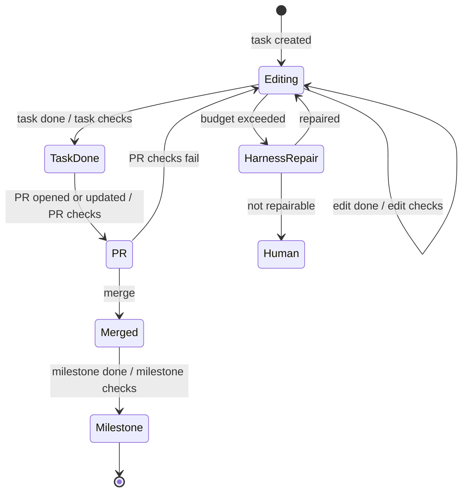

# jeer Development Process

- Status: Accepted
- Created: 2026-11-17
- Related: [jeer Design Doc](design.md) — the product itself

This document describes how we build jeer with agents. What jeer is and how it is designed are covered in the design doc.

---

## 1. Purpose
Building jeer is also an experiment in how far an agent-driven software factory can go. jeer suits this because it has an oracle (Spotless / GJF). When implementation becomes cheap, verification becomes most of the work (one practitioner reports about 70% of daily tokens going to verification [1]).

## 2. Approach
The workflow is not designed up front. It starts minimal, and techniques are added — or removed — in response to the failures we actually observe.

Every technique has a cost: run time, tokens, maintenance, false positives. A technique earns its place only when an observed failure calls for it.

### 2.1 The SDLC as a state machine
The whole development lifecycle is a state machine. Work moves between states through transitions, and checks are the guards on those transitions. A check runs when, and only when, the transition it guards is attempted. Nightly or other calendar-based runs are not used, because they are not transitions of this machine.



| Transition | Who attempts it | Guarded by | On fail |
|---|---|---|---|
| Edit done | Agent (changed files detected by a hook, §2.3) | Edit checks | Stay in Editing |
| Task done | Agent (claim caught by the Stop hook) | Task checks | Back to Editing |
| PR opened or updated | Agent | PR checks | Back to Editing |
| Milestone done | Human or agent | Milestone checks | New tasks for what failed |
| Escape | Any state, when the retry or workflow-failure budget is exceeded (§2.2) | — | Harness repair, then back to the original state; otherwise a human |

Triggers (§4) do not add a schedule. An observed trigger creates a task, which enters the machine at Editing like any other.

### 2.2 Budgets
Transitions are governed by budgets, in the manner of SRE error budgets. When to retry, escape, stop product work, or fix a check is not decided by ad hoc rules: each kind of cost has a budget, and exceeding it decides the next move.

| Budget | Charged by | When exceeded |
|---|---|---|
| Retry | Each failed attempt at a transition | Escape to harness repair |
| Workflow failure | Failures caused by the harness rather than the work: tool crashes, oracle nondeterminism, flaky tests | Stop product work and repair the harness |
| Time | A check's run time, against its test size's time limit [3] | Reorganize the check (§5) |
| False positive | Exceptions to a check (§4.1) | Fix the check |

Charging the right budget requires telling a task failure (the check found a problem in the work) from a workflow failure (the harness misbehaved). Every tool used as a check reports which one it is by exit code; otherwise the agent rewrites correct code because a tool misbehaved.

Initial values: retry 3 per transition, workflow failure 3 between milestones, false positive 3 open exceptions per check. All are adjusted from observation.

### 2.3 Realization
- **One guard CLI** (`factory`): hooks and CI only call `factory guard <transition>`. It runs the transition's checks, classifies each outcome (pass / task failure / workflow failure), records it, and decides: let through, send back, or escape. The state machine lives in this one place, and local runs and CI decide the same way

| Transition | Mechanism |
|---|---|
| Edit done | PostToolUse hook on every tool. It ignores which tool ran (agents also edit through Bash, Python, sed) and looks at files: what changed since the last passed guard, recorded as a git tree at each pass. If nothing changed, it does nothing |
| Task done | Stop hook. The agent declares the claim explicitly (`factory claim task-done`). A stop without a claim is let through (e.g. the agent is asking a question); the work stays in Editing |
| PR | CI on GitHub Actions |
| Merge | Branch protection with required checks |
| Milestone | A GitHub milestone, plus a manually dispatched workflow for large checks |

- **State** is derived from git and GitHub (a branch per task in its own worktree, the PR, whether it is merged). There is no separate state file to drift
- **Ledger**: SQLite (WAL mode) in the git common directory, shared by all worktrees and not tracked. Each transition attempt is recorded: task, transition, check, outcome, duration. Retry, workflow-failure, and time budgets are counted from it, and it is kept as the evidence for tuning budgets
- **Not in the ledger**: false-positive exceptions are counted from the code itself; the freeze flag is a labeled issue on GitHub, so CI can enforce it too; PR failures come from GitHub's check history

## 3. Minimal workflow (starting point)
The initial guards for each transition (§2.1, §2.3):

| Transition | Checks | On fail |
|---|---|---|
| Edit done | rustfmt, clippy, custom lints (below), small tests near the change | Back to edit |
| Task done | Diff against pinned Spotless on the full corpus (a sample once the full run becomes the slowest part of this gate); regression corpus; idempotency | Back to edit |
| PR | Diff against the full corpus | Back to task |

Custom lints on the code agents write:
- **Single-expression functions**: reject functions whose body is a single expression, such as a name for a condition used in one place, a call one level down to another function, a thin entry point that only hands values to a shared function, or a tiny formatting helper. These appear in 20–40% of named functions regardless of design instructions [2]
- **Results that callers branch on to recover a fact**: reject functions whose result callers inspect (as a condition, a comparison, or a match) to recover something the function had already established. That fact should be returned as a type, so later code can require it and branching stays in one place
- **Restating comments**: reject comments that restate the code or narrate the change

Custom lints are implemented by what each rule needs: ast-grep rules for the syntactic ones (single-expression functions, comments), and a dylint lint for results that callers branch on, since that needs to look at call sites.

Two things are part of the minimal setup from day one:
- **A pinned oracle**: Spotless with the latest GJF release on the latest JDK LTS, run in a fixed container, with outputs cached. Without this, nothing else is reproducible. Re-pinned when GJF releases
- **Budgets** (§2.2): retry, workflow failure, time, and false positive. Without a retry budget, a Stop hook that keeps refusing to let the agent stop can loop forever

## 4. Checks
### 4.1 Rules for every check
- **A check failure always sends the claim back.** No warnings
- **False positives are budgeted.** A false positive passes only through an explicit exception with a written reason (e.g. `#[allow(...)]` with a reason, an entry in the oracle-bug list, an equivalent-mutant mark). Exceptions are counted against that check's budget
- **Exceeding the budget means fixing the check**, not adding more exceptions: narrow the rule, change how it decides, or drop it
- **Adding an exception goes through a human**, since exceptions are also an escape hatch for agents

### 4.2 Catalog
Checks follow test sizes [3]. A check's size decides the earliest transition it can guard: small from edit done, medium from task done, large from PR.

The minimal workflow (§3) is the starting point. The rest are added when their trigger appears.

| Check | Size | Why (failure it prevents) | When | Risk | False positive |
|---|---|---|---|---|---|
| Custom lints (§3) | Small | Single-expression functions, results that discard facts, restating comments (agents write them regardless of instructions) | Every edit | Agents dodge the rule (an extra expression, inlining into one large function) | Flagged code that is right → exception with reason |
| Small tests | Small | Local breakage | Every edit | Flaky tests; tests that assert implementation details | Flaky failure → quarantine, counted against the budget |
| Diff against Spotless | Medium | Output mismatch | Every task, every PR | Once sampled at the task gate, rare constructs are missed until the PR | Mismatch caused by an oracle bug → oracle-bug list |
| Idempotency | Medium | Output that changes on a second run | Every task | Cheap; little risk | GJF itself is non-idempotent on the input → oracle-bug list |
| Normalized token comparison | Medium | A change that alters tokens it shouldn't | Every task, after a semantics bug is found | Normalization drifts from what GJF legitimately changes | Legitimate change not covered → fix the normalization |
| Bytecode comparison | Medium | Formatting that changes program meaning | Every PR, after a semantics bug is found | Heavy; only covers the compilable part of the corpus | Build-environment differences → fix the harness |
| Metamorphic (whitespace perturbation) | Medium | Output depending on input whitespace it shouldn't | Every task, after such a bug is found | Rests on our model of which whitespace GJF respects | The model was wrong → fix the model |
| Fuzzing campaign | Medium | Bugs the corpus never reaches (comments, lexical edge cases) | As a task created on trigger: the corpus stops finding new mismatches | Floods of low-value findings on inputs nobody writes | Input the oracle itself mishandles → excluded as oracle failure |
| GJF coverage (JaCoCo) | Medium | Spec the corpus never exercises | As a task created on trigger: same as above | Chasing defensive or unreachable branches | Unreachable branch → exclusion list |
| Lint against special-casing | Small | Fixes tailored to specific inputs | Every edit, once tailoring is seen | Legitimate literal tables (e.g. keywords) get flagged | Legitimate literal → exception with reason |
| Holdout set | Medium | Overfitting to the dev corpus | Every milestone | Leaks into the dev set as its failures get fixed | — (rotate it instead) |
| Separate verification agent | Large | An implementer passing its own wrong work | Every PR, after self-passed work proved wrong | Non-deterministic; tokens | A rejection with no reproducible failing input or check |
| Mutation testing | Large | Meaningless functions and missed bugs | Every milestone, and after a bug slipped past the gates | Heavy; tests written to kill mutants by asserting implementation details | Equivalent mutant → mark, counted against the budget |
| Shadow mode on real projects | Large | "High match rate" without being switchable | Before claiming drop-in compatibility | Needs cooperating projects | Diff caused by a mismatched oracle profile → fix the profile |
| Oracle determinism | Medium | Unreproducible expected outputs | As a task created on trigger: oracle output differs between runs | Cheap; little risk | — |

### 4.3 Workflow mechanisms
Not checks, but added the same way, when their trigger appears:
- **Mismatch minimization and clustering**: when there are too many mismatches to decide what to fix first
- **WIP limits / backpressure**: when parallel agents start queueing on CI or review
- **Performance loop (§6)**: when a task touches a hot path, or a performance requirement is not met
- **OTel instrumentation of tests** (phase timing per test): when a gate exceeds its latency budget, or flakiness is suspected

## 5. Adding and reorganizing techniques
- **Add** a technique when its trigger is observed, starting with the cheapest one that addresses the trigger
- **Record each check's cost**: execution time, and failure cost (false positives, flaky failures). Decisions about checks are made on cost
- **When execution time exceeds the size's limit or slows a gate, reorganize**: split the check, move it to the right size and gate, or cut redundant cases
- **When failure cost exceeds the budget, fix the check** (§4.1)
- **A check is not removed for catching nothing.** Catching nothing does not show that a check is ineffective
- **Changes to the workflow itself go through a human.** Agents propose; they don't change the checks that judge their own work

## 6. Performance loop
Once adopted (§4.3), the loop is: measure → hypothesize → change → re-measure.

- **Locate with OTel**: the product's instrumentation (design doc §10), summarized into agent-readable tables by `jeer-perf explain`, points to the phase and inputs to work on
- **Judge with benchmarks**:
  - Never a number in isolation: always compare against the merge-base, built and run on the same machine
  - Keep the measured work from being optimized away (`std::hint::black_box`)
  - Pass/fail on deterministic metrics (instruction counts, bytes allocated); wall-clock time is compared as distributions over multiple runs
- A performance change that lowers the match rate or breaks semantics is rejected
- Benchmark scenarios follow the performance requirements in the design doc (§5). Outlier inputs found with OTel are added to the benchmark corpus

## 7. References
- [1] Lauren Tan, "All Code Is Slop (Except Mine)", AI Engineer CODE 2026. https://ai.engineer/code/2026/talks/lauren-tan
- [2] toms74209200, 実験レポート「APoSD 指示は設計を変えるか」の要点. https://gist.github.com/toms74209200/3eb817af4656d1cf72370dfef55eee37
- [3] Google Testing Blog, "Test Sizes", 2010. https://testing.googleblog.com/2010/12/test-sizes.html

## 8. Conventions
The workflow above runs on [shampoo](https://github.com/toms74209200/shampoo): `.shampoo/` holds the rules, checks and policies, hooks in `.claude/settings.json` call `shampoo guard` and `shampoo policies`, and `shampoo next` drives tasks from `tasks/` to merged PRs. shampoo is the `factory` of §2.3. This section records the conventions its checks enforce, so they live in the repository and in executable checks rather than in agent memory.

### 8.1 Checks
Every check is a script under `scripts/`, called directly (not through `make`, which exits 2 on any recipe failure). Each exits 0 on pass, 1 on a task failure (the work is wrong) and anything else on a workflow failure (the check misbehaved). Tools are pinned in the scripts that run them: the Rust toolchain in `rust-toolchain.toml`, ast-grep in `scripts/ast-grep.sh`, cargo-llvm-cov in `scripts/cargo-llvm-cov.sh`, Gradle, Spotless and GJF in `oracle/`. Local runs and CI judge the same way.

| Script | Size | Checks |
|---|---|---|
| `scripts/lint.sh` | Small | rustfmt and clippy with the lints of `Cargo.toml`, warnings denied; writes `#[expect]` exceptions to `out/exceptions/lint.txt` |
| `scripts/check-sg.sh <rule>` | Small | The ast-grep rules of §3 in `sg/rules/`: comments, single-expression functions, test names, test helpers, exceptions |
| `scripts/check-branching-results.sh` | Small | The dylint lint of §3 in `tools/branching-results/` (pinned nightly and dylint in `scripts/dylint.sh`): results callers branch on |
| `scripts/check-dependencies.sh` | Small | Every crate is in `scripts/allowed-crates.txt` |
| `scripts/check-mut.sh` | Small | No production function holds more than two mutable bindings (ast-grep rules in `sg/count/`); the functions over it are listed in `scripts/mut-baseline.txt` with counts that only go down (a lower count fails until its entry is lowered) |
| `scripts/token-usage.sh [branch]` | Small | Observation only: sums the branch's token usage from the session transcripts (main and subagents, deduplicated by message) into `out/token-usage/<branch>.json`, with tokens per changed line of `src`; passes without transcripts (CI) |
| `scripts/test-small.sh` | Small | Unit tests in `src/`, with coverage to `out/small.lcov`; `scripts/judge-small-test-coverage.sh` requires 95% outside `scripts/side-effect-modules.txt`; `scripts/coverage-summary.sh` reports per module; `scripts/judge-coverage.sh` charges the coverage budget when the share of pure code drops more than one standard deviation below the base (`scripts/coverage-baseline.txt`, updated by CI) |
| `scripts/judge-side-effects.sh out/traces` | Small | Small tests run under strace (`scripts/trace-exec.sh` as the cargo runner); no network, files outside a temp dir and `target/`, or other processes. `scripts/test-judge-side-effects.sh` checks the judge on labelled traces |
| `scripts/check-commit.sh --rev <commit>` | Small | §8.2 |
| `scripts/check-fixture-commit.sh --rev <commit>` | Small | §8.4 |
| `scripts/test-fixtures.sh` | Medium | Every fixture without a skip marker passes, idempotently |
| `scripts/check-fixtures-oracle.sh` | Medium | Every expected output is the oracle's |
| `scripts/corpus-diff.sh [dev\|holdout]` | Medium | Match against the oracle on a pinned corpus; fails on files that matched at the merge-base and no longer do |

The only exception to a lint is `#[expect(<lint>, reason = "<reason>")]`; lint levels are set in `Cargo.toml`, never in code.

### 8.2 Commits
A task (a PR) is made of minimal commits: one commit, one subject, and everything staged is needed either for the subject to be true or for the checks to pass. Every commit passes the checks on its own (`.githooks/pre-commit` runs the small checks on what is staged, in a clean worktree); fixtures never share a commit with the implementation they judge (§8.4).

```
:<gitmoji>: <Verb> <what>

<optional body: why, not what>

<optional trailers>
```

- The subject is at most 72 characters and does not end with a period
- The subject describes one change: outside `code spans` it contains no `and`, `,` or `&`
- The message has no directive that skips CI (`[skip ci]`, `[ci skip]`, `[no ci]`, `[skip actions]`, `[actions skip]`, `skip-checks: true`)
- A body, if any, is separated from the subject by a blank line, and explains why
- Emoji are written as `:code:`. Merge commits are written by GitHub from the PR title and are not checked

### 8.3 Emoji and verbs
`scripts/check-commit.sh` holds the authoritative lists, taken from shampoo's development guide.

| Emoji | Use for |
|---|---|
| `:sparkles:` | New feature |
| `:bug:` | Bug fix |
| `:recycle:` | Refactoring |
| `:art:` | Code structure or format |
| `:white_check_mark:` | Tests and fixtures |
| `:memo:` | Documentation |
| `:hammer:` | Development scripts and tooling (scripts, oracle, corpus, hooks) |
| `:construction_worker:` | CI |
| `:rotating_light:` | Linter config or lint fixes |
| `:see_no_evil:` | `.gitignore` |
| `:wrench:` | Configuration |
| `:heavy_plus_sign:` / `:heavy_minus_sign:` / `:arrow_up:` | Add / remove / upgrade a dependency |
| `:fire:` | Remove code or files |
| `:truck:` | Move or rename |
| `:zap:` | Performance |
| `:pencil2:` | Typo |
| `:rewind:` | Revert |

Verbs, in the imperative: Add, Change, Update, Bump, Fix, Remove, Rename, Move, Refactor, Clean, Replace, Apply, Revert.

### 8.4 The oracle, fixtures and corpora
- **The oracle** is `oracle/`: Spotless 8.12.0 with google-java-format 2.0.0 through the Gradle wrapper, on JDK 25. `scripts/oracle.sh <profile> <in> <out>` writes the formatted file, or `<file>.error` when the oracle rejects it, caching results by content and oracle configuration under `out/oracle-cache/`. A profile names a Spotless step setup in `oracle/build.gradle.kts`
- **Fixtures** are the spec CI runs, independent of any corpus: `tests/fixtures/<profile>/<name>/input.java` is Java of our own, and `expected.java` or `expected.error` is generated by `scripts/generate-fixture.sh`, never written by hand. jeer is run as `jeer --stdin --profile <profile>` on them
- **Fixtures change in commits of their own.** A commit that changes fixtures changes no production code. A new fixture carries a `skip` marker so that it can land before its implementation; the implementation deletes the markers it makes pass, in the same commit as the code. A marker is never added to an existing fixture
- **Corpora** are pinned in `corpus/sources.tsv` and fetched locally into `out/` by `scripts/fetch-corpus.sh`; they are never committed and CI does not use them. `dev` corpora are worked against; `holdout` corpora are only measured at the milestone (§4.2)

### 8.5 Branches, merging and CI
- One task per branch and PR, branched from `master` with `git switch -c`. Nothing is pushed to `master`
- The `master` ruleset requires a PR and merge commits, and forbids force pushes and deletion. No check is required: shampoo merges a PR once the workflows its changed paths call for have passed
- Workflows follow shampoo's layout: `on-pullrequest-*.yml` decide when to run from the changed paths, `job-*.yml` hold the steps. A run may apply the formatter and push the result; it then checks what it pushed in the same run. Nothing skips CI

### 8.6 Records of the HOOTL run
For the experiment of §1, the evidence is kept where it survives the container: shampoo's ledger and statistics under `.git/`, GitHub's PRs, issues and workflow runs, and the agents' session transcripts copied to `.hootl/` (untracked). Match rates are recomputed from git history, since the oracle and the corpora are pinned.
